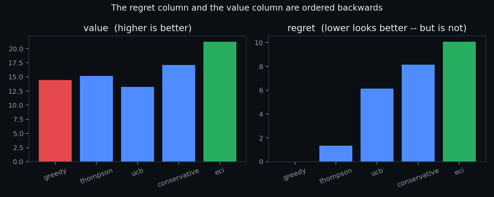
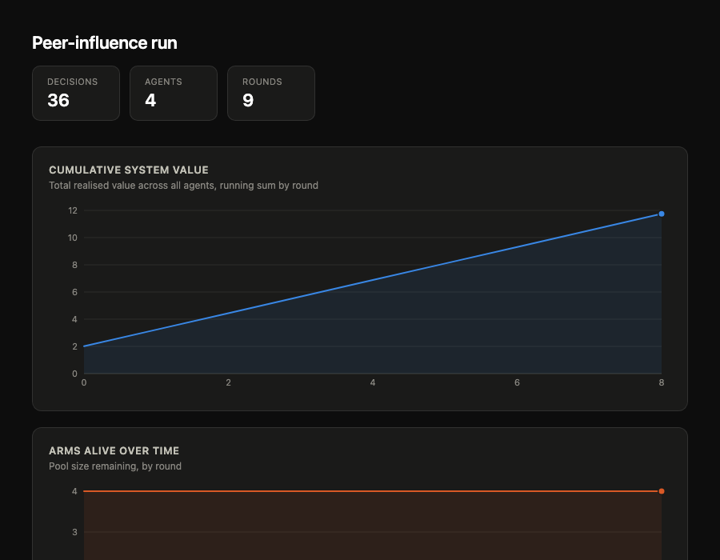

<div align="center">


*Banner artwork, not a real run — every chart elsewhere in this README is
generated from a live simulation; see [Watch it run](#watch-it-run) for the
real ones.*

# ATTRITION
### The simulator for actions that destroy what they touch

**Bandits with Consumable Action Sets**

[](https://github.com/NavikkumarModi/attrition/actions/workflows/tests.yml)
[](tests/)
[](THEORY.md)
[](pyproject.toml)
[](LICENSE)

### **No-regret is not no-harm.**

*A policy can achieve exactly zero regret while destroying unbounded value — and
its own metric will report flawless performance the entire time.*

[Why attrition](#why-attrition) ·
[Simulators](#simulators) ·
[Watch it run](#watch-it-run) ·
[Quick start](#quick-start) ·
[Domains](#domains) ·
[Research track](RESEARCH.md)

</div>

---

Most agent and bandit benchmarks measure whether a policy chose well. None of
them ask what happens when the *choosing itself* uses something up. Every
autonomous agent burning a shared API quota, every prescriber selecting for
antibiotic resistance, every fishery pulling from a stock everyone else also
depends on is playing this game, not the classical one — and its regret
metric will tell it, truthfully, that it's winning the whole time.

attrition is a testbed built around that gap: **actions that permanently
destroy the option they were taken on, with a cost that lands on everyone,
not just the taker.** Eleven results are proven formally, not just observed
empirically — see [the research track](RESEARCH.md) for the proofs. Four
scenarios run on real, live data from WHO, openFDA, NOAA, and CISA/FIRST.org
— not synthetic arrays invented to make a point. Agent populations plug into
any real LLM in one function call. A real 543-constituency India election
simulator and an AMR/pharma stewardship simulator run live in the browser.
And you can watch the failure happen, live, in a terminal, instead of
reading it off a final printout.

<div align="center">


*A live run of the pharma population layer — four prescriber personas, real
peer visibility, mechanistically-derived resistance dynamics. Generated by
`docs/make_readme_images.py`, not hand-drawn; see [Simulators](#simulators).*

</div>

---

## One engine, many worlds

There is one engine here, not a collection of separate simulators that
happen to share a repo: `ConsumableBandit`/`SimultaneousPool` for the
per-round mechanism, the same eleven theorems governing when greedy fails
and by how much, the same `Population`/`LLMPolicy` machinery for turning a
scenario into a population of agents. Every domain below — pharma, elections,
autonomous agents, fisheries, exploit catalogs — is an *instance* of that one
model, not a fork of it: a different `(v, p, e)` parameterisation of the same
`kappa = p*e` mechanism, discovered by relabelling, not by rewriting.

Scenarios are grouped into **worlds**, a label for "instances of the same
real-world phenomenon," not a claim of separate infrastructure:

| world | phenomenon | scenarios |
|---|---|---|
| `agent-ecosystem` | autonomous agents sharing API quota/credentials/tools | `shared-quota`, `shared-quota-competing` |
| `clinical-amr` | prescribing, dosing, and trial decisions consuming a shared biological/regulatory resource | `adaptive-therapy`, `antibiotic-stewardship(-real)`, `platform-trial`, `design-space(-real)` |
| `election` | campaigns contacting a shared, finite persuadable-voter segment | `campaign-persuasion`, plus the separate real-constituency population layer in `attrition/election/` |
| `environment` | extraction from a shared natural-resource stock | `fisheries-commons-real` |
| `cybersecurity` | exploitation of a shared, live vulnerability catalog | `exploit-catalog-real` |
| `synthetic` | hand-built stress cases and negative controls | `high-dispersion`, `aligned-control` |

```bash
attrition list-worlds        # or: from attrition import describe_worlds; describe_worlds()
```

The **election track** (`attrition/election/`, `election_api.py`,
`frontend/`) and the **AMR/pharma track** (`attrition.population`,
`derive_antibiotic_parameters`) are the two most developed worlds and serve
different jobs on purpose: election is the highest-visibility, most
falsifiable-in-public laboratory — real 543-constituency data, a real map, a
backtested forecasting baseline reported honestly (69.2% vs. a 66.1% naive
baseline) — while AMR is the scientifically deepest one, with a real
independently-developed reward-shaping model (`abx_amr_simulator`)
transplanted in for direct comparison. Neither is positioned as "the
product"; both are simulators built on the same underlying engine. See
[Simulators](#simulators) below for how to run each one, and
`attrition/domains.py` / `attrition/scenarios.py` for how a new world gets
added — three arrays and a label, no new engine required.

---

## Why attrition

- **Two real, running simulators**, not just a library: an interactive India
  election app (real 543-constituency data, a real map, an indicator-driven
  campaign strategist) and an AMR/pharma stewardship simulator, both reachable
  in a browser with no install.
- **Proven, not just simulated.** Eleven theorems, not slogans — see the
  [research track](RESEARCH.md) for the statements and proofs.
- **Grounded in real, live data.** Real numbers from WHO's resistance
  surveillance, openFDA's recall database, NOAA's commercial fishing
  landings, CISA/FIRST.org's exploit-probability scores, and — for the
  election track — the Trivedi Centre for Political Data / LokDhaba, DataMeet,
  Census 2011, and SHRUG.
- **Watch it happen, not just read the number.** `examples/10_live_race.py`
  renders the value gap opening up round by round in your terminal; the
  [live web app](https://attrition-world-simulator.streamlit.app/) turns any
  scenario into an interactive browser dashboard, no install required.
- **Bring your own model.** LLM-driven agent populations plug into Anthropic,
  Groq, or any provider via one function — or run entirely offline against a
  deterministic mock, no API key needed, same code path either way.
- **Own your domain.** Any consumable-choice problem — inventory allocation,
  hiring funnels, credit limits, ad-budget pacing — registers from three
  arrays, no new Python required.

---

## Watch it run

`examples/10_live_race.py` steps Greedy and ECI through the *same* scenario
round by round in a live terminal view, so the value gap isn't a number you
read at the end — it's something you watch open up as each policy's choices
accumulate. Works on any registered scenario, including the real-data ones.

```bash
python examples/10_live_race.py shared-quota --speed 0.06
python examples/10_live_race.py --list        # see every scenario
```

<div align="center">


*The one this framework describes most directly right now: an autonomous
agent — a coding agent, a browser/computer-use agent, anything making tool
calls without a human approving each one — can look flawless on every
individual call while quietly burning a shared API quota or credential pool
every other agent depends on. Postman's 2025 State of the API Report found
unauthorized agent access is developers' top-cited security risk (51%), with
46% specifically worried about agents leaking shared credentials — see
[`attrition/domains.py`](attrition/domains.py)'s `DOMAIN_NOTES["agent_tools"]`
for the full citation and what it was (and wasn't) used for.*


*Real terminal recordings (asciinema → GIF, no hand-editing), regenerated by
`docs/make_casts.sh`. More at
[`docs/images/casts/`](docs/images/casts/) — `adaptive-therapy.gif` (fast,
synthetic) and `antibiotic-stewardship-real.gif` (the WHO-data negative
control, watch the gap stay near zero). Raw `.cast` files are in
[`docs/casts/`](docs/casts/) — much smaller and scrubbable with
`asciinema play docs/casts/<name>.cast`.*

</div>

---

## The headline result

Five policies, same environments, 25 seeds:

| policy | value | regret | verdict |
|---|---|---|---|
| greedy | 14.449 | **0.000** | perfect metric, worst outcome |
| thompson | 15.171 | 1.341 | |
| ucb | 13.257 | 6.136 | |
| conservative | 17.089 | 8.160 | |
| **eci** | **21.214** | **10.069** | worst metric, best outcome |

The regret column and the value column are ordered **backwards** relative to each
other. Greedy never once fails to pull the best available arm — and ends 47%
below the policy that "looks" worst. Full proofs and the eleven-theorem
breakdown are in the [research track](RESEARCH.md).



---

## Install

```bash
git clone https://github.com/<user>/attrition
cd attrition
pip install -e .
```

Requires Python 3.9+ and NumPy. Verify the install and reproduce the headline
result in one step:

```bash
python examples/01_quickstart.py
```

Run the full check used in CI (regression tests + all 60 experiments importing
cleanly):

```bash
pip install -e ".[dev]"
pytest tests/ -v
```

## Quick start

```python
from attrition import ConsumableBandit, Greedy, ECI, Conservative, compare

env = lambda seed: ConsumableBandit.random(
    n=20, k_spread=1.5, delta=0.03, horizon=60, seed=seed)

results = compare(env, [Greedy(), Conservative(e_bound=2.0), ECI()], seeds=25)

for name, stats in results.items():
    print(f"{name:>14}  value {stats['value']:7.3f}  regret {stats['regret']:7.3f}")
```

Inspect a single session step by step:

```python
from attrition import run
result = run(env(0), Greedy(), log=True)
for row in result["log"][:10]:
    print(row)          # {'t':.., 'arm':.., 'value':.., 'regret':.., 'alive':..}
```

## Policies

| class | knowledge required | notes |
|---|---|---|
| `Greedy` | `v` | zero regret, unbounded loss |
| `ThompsonSampling`, `UCB` | — | baselines; both consumption-blind |
| `ECI` | `v`, `p`, `e` | externality-corrected index |
| `Conservative` | `v`, `p`, one bound | **recommended default** — no per-arm knowledge |
| `SortByE` | `e` | exactly optimal in pure sequencing |
| `Rollout` | base policy + simulator | 99.5–99.9% of optimum |

---

## Simulators

Two full simulators run live, on real data, with no LLM cost required —
plus a persona/population layer over cybersecurity and fisheries. This
section is how to run each one; the model underneath all of them is the
same `ConsumableBandit`/`SimultaneousPool` engine described above.

### Election: a real 543-constituency India simulator

A dedicated frontend (`frontend/`, Vite + React + TypeScript, over a FastAPI
`election_api.py`) simulating campaign effort against real 2019 Lok Sabha
election data (Trivedi Centre for Political Data / LokDhaba) for all 543 real
constituencies, joined against three more real data sources — state Assembly
results (DataMeet's AC-to-PC crosswalk), Census 2011 district demographics,
and SHRUG socioeconomic indicators (poverty, literacy, connectivity).

```bash
pip install fastapi "uvicorn[standard]"
uvicorn election_api:app --port 8000 --reload      # backend
npm --prefix frontend install && npm --prefix frontend run dev   # frontend
```

What's in it:

- **Constituency Lab** — simulate campaign contact on any one of the 543
  real seats, with a Simple mode (three effort presets, one result) and an
  Advanced mode (the full contact-intensity sequence, network propagation,
  district-granularity, counterfactual incumbency/margin overrides) —
  grounded in real research: literacy-adjusted persuasion follows Zaller's
  (1992) Receive-Accept-Sample model, checked against the literature before
  being wired into the mechanism (income/poverty and road connectivity were
  checked too, and found *not* to have a supported causal effect, so they
  stay display-only, not simulation inputs).
- **Strategist** — allocates a national campaign budget across all 543 real
  seats, greedy vs. even spreading, filterable by reservation category,
  sub-region, incumbency, and real rural poverty rate (2012 SECC); reports
  what a budget costs society (efficiency, electorate reach, states touched),
  not just how many seats it flips.
- **A real interactive map** — actual India boundary polygons (DataMeet, CC
  BY 4.0) on a free OpenStreetMap basemap, with a map-wide campaign
  simulator: the map recolours by *simulated* outcome (nationwide, one
  state, or one reservation category, with the same poverty/incumbency/
  literacy filters Strategist uses) instead of only showing the static real
  2019 result.
- **Forecast & Calibration** — a real uniform-national-swing baseline,
  honestly backtested with leave-one-state-out cross-validation on the real
  2014→2019 transition (69.2% accuracy vs. a 66.1% naive baseline).
- **Trained policy** — a real campaign-allocation policy trained from
  scratch (gradient-bandit, plain numpy), reproduced end to end in the
  browser.

A single-container Docker deployment (`Dockerfile`) serves the built
frontend and the API from one process — see `README_huggingface.md` for the
Hugging Face Spaces variant. Full development history — every real bug
found, every dataset joined and its real match-rate, every literature check
— is in `FINDINGS.md` (sections 27–65).

### Clinical/AMR: a pharma stewardship simulator

`attrition.population` runs LLM-driven prescriber personas against a shared
antimicrobial-resistance pool — mechanistically-derived resistance dynamics
(`derive_antibiotic_parameters`), not hand-set numbers. Run it from the
command line with no Python needed once a scenario is defined:

```bash
pip install -e .        # registers the `attrition` command
attrition list-domains
attrition run examples/antibiotic-stewardship.json --trace run.sqlite3
```

Any registered simultaneous-mode domain also prints a `lambda_weighted`
comparison alongside `greedy`/`eci` — the reward-shaping dial from the
independently developed `abx_amr_simulator` (Lee & Blumberg 2026),
transplanted into this repo's genuinely multi-agent, simultaneous-action
setting. Full comparison and the honest incomparability caveat (the two
engines are not on the same axis) are in
[`docs/amr-stewardship-extension.md`](docs/amr-stewardship-extension.md)
and `FINDINGS.md` sections 24–26 and 44.

`frontend/`'s Clinical/AMR tab reaches the same population layer, plus a
generic Scenario Lab (policy comparison, real LLM-population runs,
world-appropriate personas) shared with the agent-ecosystem, environment,
cybersecurity, and synthetic worlds, and an AMR reference table comparing
this repo's five policies (planner, greedy, eci, lambda-weighted, and the
external trained-checkpoint numbers) side by side.

### Cybersecurity and fisheries: a persona/population layer

`exploit-catalog-real` (real CISA KEV + FIRST.org EPSS data) and
`fisheries-commons-real` (real NOAA landings data) run the same
persona/population treatment as pharma and agent-ecosystem —
`CYBERSECURITY_PERSONAS` (a security team's remediation-rollout risk
appetite) and `FISHERIES_PERSONAS` (a vessel captain's harvest-target
appetite), reachable from the frontend's generic Scenario Lab with zero
world-specific frontend code.

```bash
python examples/22_cybersecurity_fisheries_population.py
```

### The interactive app (Streamlit)

**[Try it live — attrition-world-simulator.streamlit.app](https://attrition-world-simulator.streamlit.app/)**
— no install required. Or run it yourself: `pip install "attrition[web]" &&
streamlit run app.py`. Pick any built-in scenario (or upload your own
`v,p,e` CSV), choose which classical policies to compare, and get a
dashboard rendered live in the browser, plus an aggregate value/regret
comparison across seeds. No LLM calls and no API key needed for this part —
it's classical-policy-only, so it has no cost surface as a public
deployment.

A second, opt-in sidebar section runs a **real LLM-driven population**
(Anthropic or Groq) on whichever scenario is selected — bring your own API
key, entered in a password-masked field. The key is used only to make that
session's requests and is never logged or written to disk; it does still
pass through the app's own server process to place the call (that's how a
Streamlit app works, unlike a page that calls the provider directly from
your browser). The scenario picker has a **World** filter
(`attrition.scenarios.worlds()`, same grouping `attrition list-worlds`
prints), and the persona set offered follows the selected scenario's world —
`PHARMA_PERSONAS` for `clinical-amr`, `CAMPAIGN_PERSONAS` for `election`,
`AGENT_PERSONAS` for `agent-ecosystem`.

`app.py` stays the simpler single-file option with no Node toolchain and a
free public deployment; `frontend/` (above) is the deeper, world-specific
one, and is the only one carrying the election track.

### Dashboards, persistence, and peer visibility

`attrition dashboard <trace.sqlite3> --out dashboard.html` (or
`render_dashboard(trace, path=..., graph=...)` in Python) renders a
self-contained HTML dashboard — cumulative value, burden over time,
per-agent value, and the agent network when one was used — no server, no
CDN, opens straight from `file://`.



```python
from attrition import TraceStore, AgentGraph, simulate_population_simultaneous

store = TraceStore("run.sqlite3")        # stdlib sqlite3, no extra dependency
graph = AgentGraph.complete(["dr-conservative", "dr-aggressive"])  # or .ring/.star/.random
result = simulate_population_simultaneous(pool, population, trace_store=store,
                                           run_id="run-1", graph=graph)
df = store.to_dataframe("run-1")         # requires: pip install attrition[analysis]
```

Agents on a graph see what their neighbors chose last round — an additional
observation channel, not a different simulation; value, destruction, and
externality are still governed entirely by the unchanged `SimultaneousPool`
mechanism. `MockLLMClient(conformity=0.3)` adds a documented herding term
toward whatever arm the visible majority of an agent's peers chose. See
`examples/06_peer_influence.py`.

Both dashboard images above are generated from live runs, not hand-drawn —
regenerate them with `PYTHONPATH=. python docs/make_readme_images.py`.

### Scaling

`simulate_population_simultaneous`/`compare_population_to_baselines` take a
`max_workers` argument to dispatch each round's agent decisions (or each
seed's episode) over a thread pool — the point at which real, network-bound
LLM calls stop being wall-clock-bound by agent count. `MockLLMClient`'s
response is a pure function of its inputs, so results are identical with or
without concurrency, up to floating-point associativity.

Level 2 (LLM-driven personas) has never been run past a handful of agents
anywhere in this repo, because one real LLM call per agent per round is a
real, billable cost. `attrition.distillation.collect_decision_traces` +
`train_distilled_policy` fit a numpy-only `DistilledPolicy` that approximates
an expensive policy's decisions with zero further LLM calls —
`evaluate_agreement` reports held-out (not training-set) agreement, so a
distilled policy is never trusted blindly. See `examples/21_distill_llm_policy.py`.

The election track separately runs at up to 1,000,000 synthetic voters per
seat in well under a second (`attrition/network.py`'s
`AgentGraph.random_by_degree`, a vectorised mean-degree-parameterised graph
generator, is what makes voter-to-voter network propagation tractable at
that scale) — see `FINDINGS.md` #52–53 for the two real bottlenecks found
and fixed getting there.

### Define your own domain

Any problem with a consumable-choice structure — inventory allocation, hiring
funnels, credit-limit decisions, ad-budget pacing — registers the same way
`antibiotic-stewardship` does, from three arrays, no new Python function
required:

```python
from attrition import from_arrays, load

from_arrays(v=[...], p=[...], e=[...], name="my-domain", agents=3)
env = load("my-domain", seed=0)          # now discoverable via describe()
```

---

## Domains

Four instantiations ship with the library, each a running parameterisation rather
than an illustration. Fit quality is stated honestly.

| domain | arm | destruction (`p`) | externality (`e`) | fit |
|---|---|---|---|---|
| `agent_tools` | API-backed tool | call trips a rate limit or revokes a key | shared upstream infrastructure | strong |
| `adaptive_therapy` | dose level | dose exhausts drug-sensitive cells | released resistant clone degrades all later treatment | strong |
| `platform_trial` | treatment arm | dropped for futility on self-generated evidence | loss of concurrent control | moderate |
| `design_space` | process parameter setting | run consumes material or goes out of spec | narrows the defensible filing envelope | partial |

```python
from attrition import adaptive_therapy, Greedy, ECI, run, DOMAIN_NOTES

env = adaptive_therapy(seed=0)
print(DOMAIN_NOTES["adaptive_therapy"])
print(run(env, Greedy())["regret"])     # 0.0 -- and it loses by 49%
```

Greedy records **cumulative regret of exactly 0.0000 in all four domains**, and is
beaten in all four — by 30–49% where `κ` dispersion is largest.

### Mechanistic engines

Three domains now derive `(v, p, e)` from dynamics instead of hand-setting them
(`engines.py`): Lotka–Volterra tumour competition, a shared-control platform trial
where dropping an arm fragments the control stream, and a process-development model
where an out-of-spec run truncates the filing envelope.

**A prediction that holds both ways.** Greedy loses 26.8–121.1% (tumour) and
17.3–107% (design space) — but is **exactly optimal** in the platform trial. That
is not a failure; the theory predicts it:

| engine | std(κ) | corr(v, κ) | greedy |
|---|---|---|---|
| tumour dynamics | 0.1705 | **+0.614** | fails |
| platform trial | 0.0371 | **−0.938** | optimal |
| design space | 0.2954 | **+0.789** | fails |

Dispersion of `κ` is necessary but not sufficient — it must *conflict with the value
ordering*. A higher dose controls more tumour **and** exhausts the sensitive
compartment; an aggressive process setting yields more **and** truncates the
envelope. But promising trial arms are precisely those that won't be dropped for
futility, so they never fragment the control — value and safety are aligned, and
greedy is already right.

The failure mode belongs to domains where **ambition and damage travel together**.

**Adaptive therapy is the sharpest case.** Maximum tolerated dose — administer the
highest tolerable dose — *is* the greedy policy. Dose intensity raises immediate
tumour control, the chance of exhausting the drug-sensitive population, and the
damage done when that happens, all together.

This domain is now **mechanistically grounded**: `(v, p, e)` are derived from
Lotka–Volterra competition dynamics rather than set by hand.

```python
from attrition import derive_arm_parameters
v, p, e, doses = derive_arm_parameters(engine_kwargs={"dt": 5.0}, s0_sd=0.26)
```

On those derived parameters MTD records private regret of **exactly 0.000000** and
loses 5.2% / 17.4% / 36.9% of system value at δ = 0.05 / 0.15 / 0.30.

Running the dynamics with no bandit layer at all, and measuring time to progression
(the clinical endpoint — final burden cannot distinguish protocols, since the
resistant clone always reaches carrying capacity eventually):

| protocol | time to progression | vs MTD |
|---|---|---|
| MTD (always max dose) | 26 | — |
| adaptive, back off at S<0.40 | 38 | +46% |
| adaptive, back off at S<0.50 | **44** | **+69%** |

Competitive release is reproduced, not assumed. Still a two-compartment reduced
model with no spatial structure or pharmacokinetics — no clinical conclusion should
be drawn from it.

See `experiments/exp25_domains.py` for all four, and
`experiments/exp17_agent_ecosystem.py` for a session trace where the greedy
router's dashboard shows a flawless zero-regret record while it burns the
ecosystem to a worse outcome with fewer tools remaining.

### Grounded in real data

A third tier alongside hand-set (above) and mechanistic (`engines.py`):
`(v, p, e)` derived from actual external measurements, not this repo's own
simulation. Checked-in snapshots under `attrition/data/`, refreshed by
`python scripts/fetch_real_data.py` (stdlib only, no new dependency).

| scenario | real source | what's actually measured |
|---|---|---|
| `antibiotic-stewardship-real` | [WHO Global Health Observatory](https://ghoapi.azureedge.net/api/) | `p` — real MRSA/E. coli resistance proportion, ~1,005 country/year rows |
| `design-space-real` | [openFDA drug enforcement](https://api.fda.gov/drug/enforcement.json) | `p` — real fraction of Class I (most severe) recalls per failure category, from 15,556 real records |
| `fisheries-commons-real` | [NOAA Fisheries FOSS landings](https://apps-st.fisheries.noaa.gov/ods/foss/landings/) | `p` — real year-over-year landings-decline frequency, 16 species across 1,143 species-year records (most 1950–2024) |
| `exploit-catalog-real` | [CISA KEV](https://www.cisa.gov/known-exploited-vulnerabilities-catalog) + [FIRST.org EPSS](https://www.first.org/epss/) | `p` — EPSS itself, a real live exploitation-probability score (not a proxy for one), for 1,671 real actively-exploited CVEs |
| `agent_tools`/`shared-quota` | Postman "State of the API" (2025) + Datadog "State of AI Engineering" (2026) | cited as supporting evidence only — see caveat below |

> [!NOTE]
> **Only one of `(v, p, e)` is real-measured in each case** — the other two
> are documented proxies, stated as such in `real_data.SOURCES`, never
> presented as equally real.

**Actual output of `python examples/07_real_world_grounded.py`** (unedited,
reproduced from the checked-in snapshots — nothing below is hand-typed):

```
Real WHO resistance rows (a few, for a sanity check):
      IDN-2021  measured resistance = 71.1%
      FIN-2021  measured resistance = 6.3%
      ARE-2018  measured resistance = 23.7%
      TUN-2019  measured resistance = 17.4%
      IRL-2023  measured resistance = 10.8%

antibiotic-stewardship-real -- n=200 real (country, year) arms, 15 seeds:
    greedy  value= 39.382  regret=  0.000
       eci  value= 39.382  regret=  0.000
  corr(v, kappa) = -0.963 -- the ALIGNED regime, value gap +0.0%

design-space-real -- 9 real FDA failure categories, 200 seeds:
    greedy  value=  4.606 (se 0.091)  regret=  0.000
       eci  value=  4.625 (se 0.074)  regret=  0.110
  corr(v, kappa) = -0.196 -- no strong alignment, value gap -0.4%

fisheries-commons-real -- 16 real NOAA species, 200 seeds:
    greedy  value= 17.339 (se 0.480)  regret=  0.000
       eci  value= 21.609 (se 0.388)  regret=  7.992
  corr(v, kappa) = +0.738 -- the CONFLICT regime, value gap -19.8%

exploit-catalog-real -- 1,671 real CVEs, n=200 subsample, 200 seeds:
    greedy  value= 57.480 (se 0.369)  regret=  0.000
       eci  value= 58.352 (se 0.214)  regret=  0.495
  corr(v, kappa) = -0.167 -- no strong alignment, value gap -1.5%
```

> [!IMPORTANT]
> The first result is an **honest negative finding, not a bug**. The default
> `antibiotic-stewardship-real` proxy (`v = 1-p`, `e = p`) makes
> `kappa = p*e` a *deterministic* function of `v`, landing it in the
> **aligned** regime (like `platform-trial`) purely by construction of that
> formula — greedy and ECI coincide there because of the proxy, not because
> of anything discovered about real antibiotic resistance. `design-space-real`'s
> gap is real but small (checked at 200 seeds, not tuned up by cherry-picking
> a seed count that happens to look better). Neither result was swapped for
> a formula chosen to look more dramatic — see `real_data.py`'s docstrings
> and `examples/07_real_world_grounded.py` for the full run.
>
> `fisheries-commons-real` is the other side of that same honesty: it's the
> first real-data scenario in this repo to land in the **conflict** regime by
> nothing more than what the real landings data says (`corr(v, kappa) =
> +0.74`, not tuned to get there) — the U.S. species with the highest real
> per-pound price and total value (lobster, sea scallop) are also the ones
> with the highest `kappa`. Greedy naturally prefers exactly the arms a real
> fishery can least afford to over-exploit, and still posts zero private
> regret while doing it.
>
> `exploit-catalog-real` is different in kind, not just topic: `p` here
> isn't a computed ratio standing in for a probability, it **is** one —
> FIRST.org's EPSS score, a real, live, independently-validated probability
> of exploitation, for CVEs CISA has already confirmed are being exploited.
> The gap it produces is small (comparable to `design-space-real`'s), and
> that's reported as-is rather than swapped for a bigger one — the point of
> this domain is the directness of `p`, not the size of the effect.

`agent_tools`/`shared-quota`'s roster numbers are **unchanged**. Postman's 2025
State of the API Report found unauthorized agent access is developers'
top-cited security risk (51%, with 46% specifically worried about credential
leakage) and Datadog separately measured real production rate-limit error
rates (2-5% of LLM call spans, majority from exceeded quota) — both real and
current, but both measure a different quantity than this roster's `p`
(per-call/opinion rate vs. probability-this-pull-exhausts-the-tool), so citing
them to recalibrate the numbers would be a fake precision upgrade, not a real
one. See `DOMAIN_NOTES["agent_tools"]`.

---

## Further reading

- **[RESEARCH.md](RESEARCH.md)** — why the numbers above can be trusted: the
  eleven proven theorems, the correlated-destruction/SECI extension, the
  multi-agent price-of-anarchy result, and what was tried and falsified.
- **[THEORY.md](THEORY.md)** — formal statements, proofs, and proof routes.
- **[FINDINGS.md](FINDINGS.md)** — the full lab notebook: every real bug
  found, every dataset joined, every literature check made, session by
  session, across both the research track and the election/AMR simulators.
- **[docs/amr-stewardship-extension.md](docs/amr-stewardship-extension.md)**
  — the AMR/pharma reward-shaping comparison against `abx_amr_simulator`.

## Citation

```bibtex
@misc{attrition,
  title  = {No-Regret is Not No-Harm: Bandits with Consumable Action Sets},
  author = {Modi, Navikkumar},
  year   = {2026},
  note   = {https://github.com/<user>/attrition}
}
```

## License

MIT
