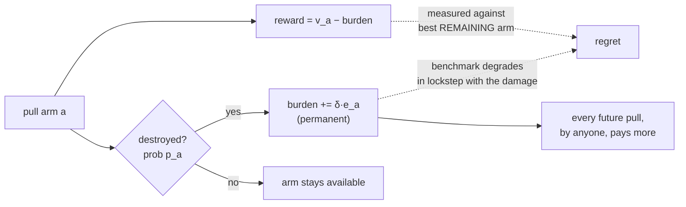

# attrition — Research Track

This is the theoretical and empirical case behind the simulators in
[README.md](README.md): why greedy's zero regret coexists with unbounded
harm, the eleven proven results, and what was tried and failed. If you
came here to run a simulator, [README.md](README.md) is the door — this
document is why its numbers can be trusted, not how to use it.

Formal statements and full proofs live in [THEORY.md](THEORY.md); the
session-by-session development log (every real bug found, every dataset
joined, every check that failed before something shipped) is
[FINDINGS.md](FINDINGS.md). This document is the connective narrative
between them — proofs and documented falsifications, not intuition.

---

## Why this happens

Regret is measured against the best arm *currently available*. When your own
actions remove arms, the benchmark degrades in lockstep with the damage you
cause. Every choice greedy makes is optimal **given the environment it has
already ruined**.

```
regret(greedy) = 0            always, by construction
V_opt - V_greedy = m · δE     unbounded in pool size m and externality δE
```



The regret benchmark and the damage share a cause, so a policy that only
watches regret cannot see the damage it is doing — it is watching a
scoreboard that updates itself to match whatever the policy just broke.

## The model

Arm `a` has value `v_a`, destruction probability `p_a`, and externality
coefficient `e_a`. Pulling `a`:

- yields `v_a − B(S)`, where `B(S) = δ · Σ_{dead i} e_i` is accumulated burden;
- destroys `a` with probability `p_a`, permanently adding `δ e_a` to `B`.

The governing quantity is the **expected marginal externality**

```
κ_a = p_a · e_a
```

## Results

| | statement | status |
|---|---|---|
| **T1** | greedy is optimal **iff** `κ_a` is constant across arms | proven |
| **T2** | ECI index `v_a − δ κ_a (T−t)` captures 52–99% of the gap | empirical |
| **T2b** | pure sequencing: optimal order is **ascending in `e`**; values are irrelevant | proven |
| **T3** | `SE(δê) ≥ 2σ/√min(T, Σ 1/p_j)` — **independent of horizon** | proven |
| **T4** | zero-regret policy loses `m·δE`, unbounded | proven |

### T1 — what actually matters is the product

Neither `p` nor `e` alone. Holding `p·e` constant while varying both factors
widely leaves greedy **exactly** optimal (0/10 instances broken); varying the
product breaks it in 10/10.

### T3 — the externality cannot be learned

Estimating `e_i` requires comparing rewards before and after arm `i` dies.
Destruction is irreversible, so **each arm supplies exactly one such
transition**. The sample budget is capped by the pool, not the clock:

| `p` range | rounds of data | corr(ê, e) |
|---|---|---|
| [0.90, 1.00] | 8.5 | **+0.118** |
| [0.25, 0.50] | 23.0 | +0.261 |
| [0.04, 0.10] | 60.0 | **+0.828** |

A 16× increase in horizon changes RMSE by *zero* at `p = 0.9`. The data-generating
process is the consumption itself.

> **Specify, don't estimate.** `Conservative`, which assumes a uniform upper bound
> and learns nothing, beats every learned estimator tested.

### T4 — the proof

`m+1` arms: one "hot" (value 1, externality `E`) and `m` "safe" (value `1−ε`,
externality 0), with `p = 1`.

Greedy takes hot first and pays `δE` on all `m` remaining pulls. The optimum
defers hot to last and pays it zero times.

```
V_opt − V_greedy = m · δE          exact, verified 15/15 against DP
```

At `m = 12`, `δE = 2`: optimum `+12.88`, greedy `−11.12`. Regret: `0.0000`.

## Terminal commitment

A distinct problem in the same family: a finite budget of irreversible experiments,
then a **one-shot declaration** that fixes the feasible set for good. Motivated by
CMC design-space filing under ICH Q8 — operating inside the declared envelope needs
no approval, outside it triggers a variation.

```python
from attrition import (evaluate_commitment_policy, edge_first_policy,
                              expand_outward_policy)
evaluate_commitment_policy(expand_outward_policy, budget=2)
```

| budget | policy | operating value | envelope width |
|---|---|---|---|
| 2 | greedy (best yield first) | 36.908 | **1.00** |
| 2 | edge-first (chase width) | 36.908 | **1.00** |
| 2 | **expand outward** | **43.271 (+17.2%)** | **2.91** |
| 6 | edge-first | 36.908 (**−18.1%**) | **1.00** |

**Two failure modes, both absent from the sequential setting.**

*Greedy buys yield it cannot claim.* An envelope is an interval containing the
nominal point, so demonstrating a distant high-yield setting is worthless unless
everything between is demonstrated too. At budget 2 greedy ends with width 1.00.

*Ambition narrows the envelope it was trying to widen.* Edge-first targets the
outermost settings to maximise claimable width — and each failure blocks that
setting permanently. Its width is 1.00 at **every** budget, and it gets *worse* as
budget grows (−10.8% → −18.1%). **Spending more to widen the envelope makes it
narrower.**

Note the advantage of the correct policy *shrinks* with budget, the opposite of the
sequential setting. Terminal commitment is about scarcity of evidence at the moment
of an irreversible decision; given enough evidence the problem dissolves. It is
hardest exactly when experiments are expensive.

## Correlated destruction, and SECI

Every result above assumes destruction is independent across arms. That's false
in exactly the domains motivating this project — a shared API outage kills
several tools at once; a class-wide toxicity mechanism can invalidate several
doses together; a common supplier failure blocks several process settings at
once. We tested what survives when arms are clustered and share correlated
exogenous shocks (each round, a shock can destroy every alive member of a
cluster at once, independent of what was pulled).

**Zero-regret vacuity survives, trivially** — it's a property of the benchmark
definition, holding under any destruction mechanism.

**The greedy characterisation survives exactly, and this is a genuine surprise.**
Constant κ still gives greedy exact optimality under correlated shocks, verified
to full floating-point precision even with `e` varying sixfold within a cluster.
Stated as a **conjecture**, not a theorem — a proof attempt was made and
abandoned rather than forced through, since this project has already been burned
once by a plausible-looking but false lemma.

**ECI does not survive.** At high correlated-shock rates ECI is worse than plain
greedy in the majority of instances tested (13/15 at q=0.7) — it keeps paying a
preservation cost for protection a shock destroys regardless of whether the arm
was pulled.

**SECI fixes it:**

```python
from attrition import SECI
SECI(q=0.15)   # q = per-cluster shock rate; reduces exactly to ECI at q=0
```

`I(a,t) = v_a − δ·p_a·e_a·(T−t)·(1−q)²`. Matches or beats greedy at *every* q
from 0 to 1, confirmed by exact DP (30 seeds), staying within 0.01–1.53% of true
optimum. An apparent shortfall at scale (n=40) was diagnosed rather than
accepted: it turned out to be an experimental-design artifact — `δ` held fixed
while `n` grew made larger-n instances unfairly harder, not a failure of the
correction. Rescaling `δ` to keep problem difficulty comparable across scale
closes the gap to noise level.

Still an **empirical** result — the `(1−q)²` form was found by testing against
exact DP, not derived and proven from the Bellman structure the way ECI was. A
more theoretically motivated attempt (an effective-horizon correction) was tried
and performed *worse*, which is itself useful: testing against ground truth
caught a plausible-looking wrong derivation before it shipped.

**A concern that SECI's improvement over greedy "doesn't look great" was
checked directly, at real (exact, not simulated) scale.** Exact DP goes further
than n=6 — n=12 runs in ~12 seconds. At n=12:

| q | greedy gap to optimum | **SECI gap to optimum** |
|---|---|---|
| 0.0 | 7.2% | **1.80%** |
| 0.4 | 1.1% | **0.29%** |
| 0.8 | 0.0% | **0.03%** |

SECI captures 4–5× more of the available opportunity than greedy at every q
where meaningful opportunity remains. The absolute margin shrinks with q
because the *opportunity itself* shrinks — not because SECI weakens.

A Monte Carlo rollout was also tried as an independent large-n reference, and
was abandoned after failing a sanity check (a real RNG-sharing bug, found and
fixed, but the result remained untrustworthy even after fixing) rather than
reported as a finding.

See `experiments/exp50_correlated_destruction.py` and `THEORY.md` for the full
diagnosis.

## Environments and scenarios

Gym- and PettingZoo-compatible interfaces, implemented natively so there is no
RL-framework dependency:

```python
from attrition import load, describe

describe()                              # list all scenarios and what they show

env = load("shared-quota", seed=0)      # Gym API
obs, info = env.reset(0)
obs, reward, terminated, truncated, info = env.step(action)

menv = load("shared-quota-competing")   # PettingZoo parallel API
obs, rewards, terms, truncs, infos = menv.step({a: 0 for a in menv.agents})
```

**Observations deliberately hide the true externality coefficients.** Theorem 3
says they cannot be reliably estimated from experience, so an agent that read them
off the observation would be solving a different problem. Pass
`reveal_externality=True` for oracle experiments.

### Multi-agent: there is no price of anarchy

**Theorem (sequential equivalence).** On a shared pool, if agents act one after
another and observe each other's results, *m* agents over *T* rounds is **exactly**
one learner over *m·T* pulls. Decentralised greedy agents therefore behave
identically to a single greedy learner.

Simultaneous action doesn't change it — PoA is 1.00 at zero κ dispersion even when
agents cannot see each other's current choices, and below the single-agent gap
otherwise.

**Why:** in a classical commons my consumption harms you and not me. Here the burden
is subtracted from *every* agent's reward including my own. The externality is
symmetric, so a greedy agent behaves the same whether m=1 or m=10. There is nothing
to free-ride on when no one is paying.

**Checked at real scale, not just m≤6 — up through m=20,000.** Every
multi-agent test in this repo had topped out at 6 agents — the exact-planner
PoA baseline is exponential in m and can't go further, but the simulation
itself has no such limit; it had just never been asked.
`experiments/exp61_population_scale.py` ran both claims on real data
(`antibiotic-stewardship-real`, 200 WHO-derived arms): sequential
equivalence holds exactly at m=200 (33x past anything previously tested,
and fast — 11ms), and simultaneous-action's price of anarchy **saturates to
an exact step function**, not a gradual curve — pinned to the identical
per-agent value from m=85 all the way to m=20,000 (100x the pool size).
The mechanism is provable from `SimultaneousPool.step()` itself, not a
property of this scenario's `delta`: every colliding agent's reward comes
from the same pre-round burden, and the destruction check short-circuits
once an arm dies, so once agent density guarantees a hit within the round,
more agents are provably inert. See `FINDINGS.md` #22 — the first-pass
"it's just a small delta" explanation didn't survive pushing the scale
further, and is corrected there rather than left standing.

What *is* genuinely multi-agent: free-riding — pricing the externality but
discounting by your own share (δκ/m). Theorem 6 makes this analysable as a
single-learner question, since it's just ECI with a mis-scaled charge.

| λ | reading | raw loss |
|---|---|---|
| 0 | greedy | 1.3734 |
| 1/8 | 8 agents | 0.7030 |
| 1/2 | 2 agents | 0.2262 |
| 1 | correct pricing | 0.0843 |

Even an eightfold discount recovers **50–63%** of the gain over greedy — crude
partial pricing beats none by a lot.

**Over-charging is safer than under-charging**, in 8 of 9 settings, by ratios from
3× to 20×. Since Theorem 3 says the scale can't be estimated anyway:

> **Err high.** The estimate doesn't need to be good, provided the error is on the
> high side.

(There's no universal best λ — the minimiser ranges 0.6 to 3.0 across settings, so
any specific recommendation would be overfitting.)

### Scenario packs

Each scenario documents the phenomenon it should exhibit, and the test suite
asserts it — so a scenario that drifts is a detectable regression.

| scenario | std(κ) | corr(v,κ) | greedy loss | greedy regret |
|---|---|---|---|---|
| `high-dispersion` | 0.6285 | +1.000 | **176.5%** | 0.00000000 |
| `design-space` | 0.2954 | +0.789 | 99.3% | 0.00000000 |
| `adaptive-therapy` | 0.1705 | +0.614 | 36.9% | 0.00000000 |
| `shared-quota` | 0.9948 | +0.315 | 3.7% | 0.00000000 |
| `platform-trial` | 0.0371 | −0.938 | **0.0%** | 0.00000000 |
| `aligned-control` | 0.6299 | −0.971 | **0.0%** | 0.00000000 |

The last two are negative controls: κ is dispersed but *aligned* with value, so
greedy is already optimal and the theory says so. `shared-quota-competing` adds a
second agent for price-of-anarchy experiments.

## Paper

One document (`no-regret-is-not-no-harm.tex`), built from `body.tex` plus
`sections_long.tex`, which is pulled in as a clearly-marked appendix (a
divider page, then `\appendix` so the sections letter as A, B, C...). The same
source targets JMLR and arXiv, so there is nothing to keep in sync.

```bash
cd paper && make                # figures + the PDF
make submission.tar.gz          # upload bundle
```

For a JMLR submission specifically, swap the preamble for
`\documentclass[wcp]{jmlr}` and add `jmlr.cls` (distributed from jmlr.org) --
`body.tex` and `sections_long.tex` need no changes either way.

The long-form version adds `sections_long.tex` via a `\LONGFORM` macro: price of
anarchy under consumption, terminal commitment, a notation table, and a software
section. The conference builds define the macro empty.

arXiv imposes no mandatory template; `arxiv.sty` is the community convention. The
official `jmlr.cls` is distributed from jmlr.org — swap the preamble for
`\documentclass[wcp]{jmlr}` before submitting. All formatting is confined to the
wrapper files, so the body needs no changes for any venue.

## Reproducing

```bash
python -m pytest tests/          # 21 tests, one per theorem
python experiments/exp21_theorem4_construction.py    # T4, exact
python experiments/exp22_theorem3_proof.py           # T3, three parts
python experiments/exp24_remaining_theory.py         # T1 necessity, T2b
```

`experiments/` contains all 24 experiments in order, including the ones that
failed. `FINDINGS.md` is the lab notebook; `THEORY.md` holds statements, proofs,
and proof routes.

## What was falsified

Recorded rather than deleted, because the negative results shaped the theory:

- **IPIC**, a preservation heuristic — lost to plain greedy in every regime; its
  premise (valuable arms are worth preserving) is false without externalities.
- **The endogenous/exogenous unification claim** — rotting bandits already
  handle both (Seznec et al. 2020).
- **The effective-horizon index refinement** — made the index worse.
- **Horizon-scaling of the T4 gap** — the gap is flat in `T`, linear in pool size.
- **ECI exactness in pure sequencing** — brute force found better orderings.
- **Per-arm and feature-based learning of `e`** — the feature route's capture
  *falls* as sharing increases, because low dispersion means nothing to capture.

## Related work

- **Rotting bandits** (Levine et al. 2017; Seznec et al. 2019, 2020) — rewards
  decay with pulls or time. Decay is gradual, not removal, and the regime is known.
- **Mortal bandits** (Chakrabarti et al. 2008) — arms expire, but exogenously.
- **Blocking bandits** — unavailability is temporary.
- **Bandits with knapsacks** (Badanidiyuru et al.) — closest neighbour;
  consumption against a **global exogenous** budget, without cross-arm reward coupling.
- **Positive externalities** (Shah, Johari & Scheinkman, NeurIPS 2018) —
  externalities act on **arrivals** and are positive; they also show UCB incurs
  linear regret, a parallel failure of a standard algorithm under externality
  structure.

---

Back to [README.md](README.md) for the simulators themselves, or
[FINDINGS.md](FINDINGS.md) for the full, session-by-session development log
behind every claim above.
